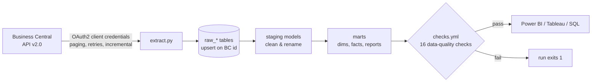
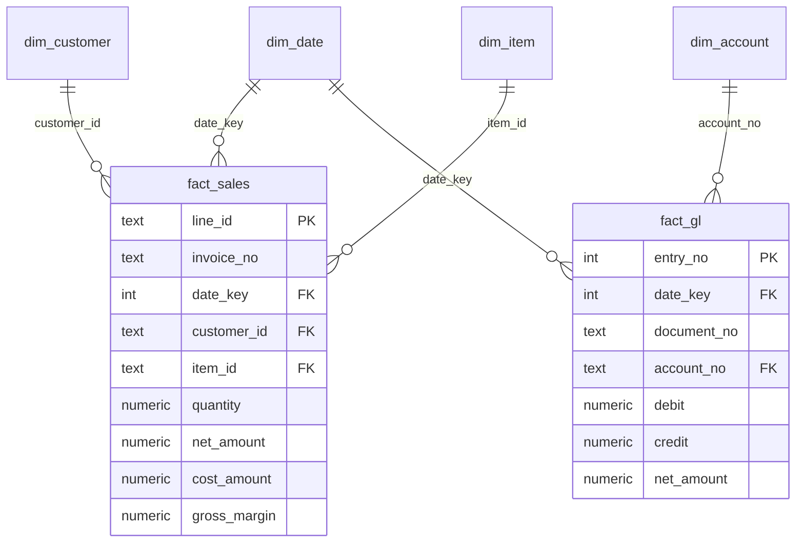

# ERP Data Pipeline: Business Central → PostgreSQL warehouse


A small, production-shaped ELT pipeline that pulls finance and sales data out of **Microsoft Dynamics 365 Business Central**, lands it in a **PostgreSQL** warehouse, models it into a star schema, and refuses to publish numbers that don't add up.

It runs end to end against a bundled **mock Business Central API**, so you can try it without a BC tenant. Point it at a real BC environment by changing a few environment variables.



## What it does

| Stage | What happens | Why it matters |
| --- | --- | --- |
| **Extract** | Calls BC API v2.0 entity sets (G/L entries, customers, vendors, items, accounts, sales invoices and lines). Follows `@odata.nextLink` paging. | BC pages results server-side; a naive client silently stops at the first page. |
| | OAuth 2.0 client credentials (Microsoft Entra ID); token cached and refreshed on 401. | Same flow you'd use for a real SaaS tenant. |
| | Retries 429 and 5xx with `Retry-After` or exponential backoff, then fails loudly. | BC SaaS throttles API calls under load. |
| | Incremental: `$filter=lastModifiedDateTime gt <watermark>` with a short lookback. | Nightly runs move only what changed. |
| **Load** | Typed `raw_*` tables, `INSERT … ON CONFLICT DO UPDATE` keyed on the BC `id`. | Re-runs and overlapping windows never duplicate rows. |
| | One watermark per entity in `pipeline_state`. | Each entity resumes where it left off. |
| **Transform** | Plain SQL models in `models/staging` then `models/marts`, rebuilt every run. | Easy to review, easy to port to dbt. |
| **Check** | 16 checks in `checks.yml`: keys, relationships, and accounting rules. | A finance warehouse is only useful if the books balance. |

### The accounting checks

Besides the usual unique / not-null / foreign-key checks, the pipeline enforces rules an accountant would check by hand:

- **Every document balances**: debits = credits per document number.
- **Trial balance is zero** across the whole ledger.
- **Invoice headers match their lines** (amount excluding tax).
- **Sales reconcile to the revenue account**: `fact_sales` net sales = credits on G/L 4100.
- Warnings for negative quantities and lines sold far below cost.

A failed `error` check makes the run exit with code 1, so a scheduler or CI marks it red and nobody builds a report on bad data. The test suite proves this by injecting an unbalanced G/L entry.

## Data model



Report tables built on top:

- `rpt_monthly_pnl`: income, cost of goods sold and expenses by month.
- `rpt_ar_aging`: open receivables in buckets: Not due, 1–30, 31–60, 61–90, 90+ days.

Staging also cleans the master data the way real BC data needs it: trims stray spaces from names, upper-cases country codes, and lower-cases emails.

## Run it

**Quickest: Python only, no database server**

```bash
pip install -r requirements-dev.txt
python -m pipeline.run --mock --warehouse sqlite:///warehouse.db
pytest -v
```

The run prints a JSON summary: rows loaded per entity, models built, checks failed or warned, and run time.

**Full stack with Docker: PostgreSQL + mock BC + hourly pipeline**

```bash
docker compose up --build
```

Then connect Power BI, Tableau or any SQL client to `localhost:5432` (user, password and database are all `erp`).

**Against a real Business Central environment**

1. Register an app in Microsoft Entra ID and grant it the Business Central API application permission.
2. Add the app on BC's **Microsoft Entra Applications** page and give it read permission sets.
3. Copy `.env.example` to `.env`, fill in the tenant, environment, client ID and secret, then run `python -m pipeline.run`.

| Flag | Effect |
| --- | --- |
| *(none)* | Incremental run from the stored watermarks |
| `--full-refresh` | Ignore watermarks and reload everything (still idempotent) |
| `--mock` | Start the mock BC API in-process and run against it |
| `--warehouse URL` | `sqlite:///file.db` or `postgresql://…` |

## Project layout

```
pipeline/
  extract.py        BC API client: OAuth, paging, retries, incremental filter
  load.py           entity → raw table mapping, upserts, watermarks
  transform.py      runs models/ in order, builds dim_date, per-database macros
  quality.py        turns checks.yml into SQL and reports failures
  warehouse.py      PostgreSQL and SQLite connections
  run.py            CLI orchestrator
  mock_bc/          mock BC API v2.0 + deterministic sample data
models/
  staging/          one cleaned table per BC entity
  marts/            dims, facts, P&L and receivables ageing
checks.yml          data-quality rules
tests/              20 tests: extract, load, end-to-end, PostgreSQL (in CI)
```

## Design notes and limits

- **SQL models instead of dbt**: the models are plain SQL in dbt's folder style, so they port to dbt models with `ref()` in an afternoon. Keeping them plain keeps the project dependency-light and easy to read.
- **Deletes**: BC's API doesn't expose deleted records through `lastModifiedDateTime`. Posted ledger entries are never deleted in BC, but master data can be; a periodic `--full-refresh` handles that here. Production would compare ID lists or use BC's change-log webhooks.
- **Cost of sales** uses each item's current unit cost. Production would read the **Value Entry** table for the exact cost posted.
- **SQLite** is only for local runs and tests. Model SQL is written to run on both, with the one date-difference expression handled by a macro. CI runs the full suite against a real PostgreSQL 16.
- The sample data is generated (seeded, so it's the same every run). No real company data is used.

## Related

- [bc-payment-reconciliation](https://github.com/KulaniMelaku65/bc-payment-reconciliation): AL extension and Node.js middleware for matching payment-gateway settlements in Business Central.
- Next: a Power BI and Tableau finance dashboard built on this warehouse.

## License

MIT
